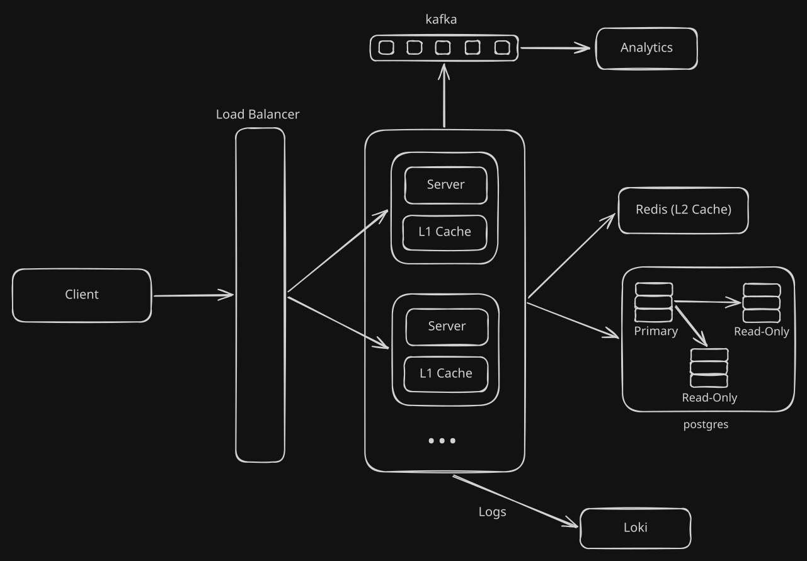

# Zipr

URL shortener backend — Fastify, TypeScript, Prisma, PostgreSQL, Redis.

Auto short URLs are derived from the database `id` via Base62 (`encodeBase62(id)`); Pro users can also pick a custom slug.

## System design



## Stack

- Node.js + TypeScript (strict, ESM)
- Fastify 5
- Prisma 7 + PostgreSQL (`@prisma/adapter-pg`)
- Two-level cache: in-memory, then Redis (`ioredis`)
- JWT auth (`jose`) + bcrypt

## Setup

### Whole stack in Docker

```bash
cp .env.example .env   # fill in the values (see below)
sudo docker compose up --build -d
npx prisma generate
POSTGRES_HOST=localhost npx prisma migrate deploy   # migrations do not run on their own
```

The app answers on `http://localhost` (host port 80), Swagger UI at `/docs`. Migrations go through the `pgpool` port published on the host (`POSTGRES_PORT`), so `POSTGRES_HOST` must be `localhost` for that command; the `app` container overrides it to `pgpool`.

`docker compose down` keeps the data; `docker compose down -v` deletes the Postgres and Redis volumes, and `migrate deploy` has to be run again afterwards.

### App outside Docker (development)

```bash
npm install
sudo docker compose up pgpool pg-0 pg-1 pg-2 redis -d
npx prisma generate
npx prisma migrate deploy
npx tsx src/main.ts    # or: npm run build && npm start
```

Here the server binds `API_HOST=127.0.0.1` and listens on `http://localhost:$API_PORT`.

### Environment variables

| Variable | Used by | Meaning |
|----------|---------|---------|
| `API_PORT`, `API_HOST` | app | Port and bind address. `127.0.0.1` outside Docker; compose forces `0.0.0.0` inside the container, where the `80:$API_PORT` mapping is what exposes it |
| `JWT_SECRET` | app | HS256 signing key |
| `POSTGRES_DB`, `POSTGRES_USER`, `POSTGRES_PASSWORD` | app, cluster | Application database and its role |
| `POSTGRES_HOST`, `POSTGRES_PORT` | app | Where the app reaches Postgres (`pgpool`, published on `POSTGRES_PORT`) |
| `ADMIN_USERNAME`, `ADMIN_PASSWORD` | cluster | `postgres` superuser password and the pgpool admin |
| `RPMGR_USER`, `RPMGR_PASSWORD` | cluster | repmgr replication user |
| `REDIS_HOST`, `REDIS_PORT`, `REDIS_PASSWORD` | app, redis | Cache connection |
| `ADMINER_PORT`, `REDIS_INSIGHT_PORT` | compose | Host ports of the DB and Redis UIs |

## Architecture notes

- **Database:** three PostgreSQL nodes managed by repmgr (`pg-0` primary, `pg-1` and `pg-2` standbys) behind `pgpool`, which sends writes to the primary and load-balances reads. Replication is asynchronous (`POSTGRESQL_NUM_SYNCHRONOUS_REPLICAS=0`), so a read right after a write can briefly see old data.
- **Cache:** every entry expires after 10s in both levels (in-memory, then Redis). Redis config lives in `docker/redis.conf`.
- **Tools:** Adminer on `http://localhost:$ADMINER_PORT` (system `PostgreSQL`, server `pgpool` or `pg-0`/`pg-1`/`pg-2`, user `POSTGRES_USER`, database `POSTGRES_DB`); RedisInsight on `http://localhost:$REDIS_INSIGHT_PORT`.

## Known limitations

- `GET /` answers `400 Invalid Url` instead of 404.
- Two concurrent requests creating the same user or slug can end in a 500 instead of a 409.
- Routing of `nextval()` and of reads right after writes through pgpool is not verified.

## API

| Method | Path | Auth | Description |
|--------|------|------|-------------|
| `GET` | `/health` | — | Health check |
| `POST` | `/user/create` | — | Create a user (`email`, `password`) |
| `POST` | `/user/login` | — | Log in with `email` + `password`, returns a JWT |
| `POST` | `/shorten/auto` | JWT | Create an auto-generated short URL (`longUrl`) |
| `POST` | `/shorten/custom` | JWT, `Tier.Pro` | Create a short URL with your own slug (`longUrl`, `shortUrl`) |
| `GET` | `/a/:shortUrl` | — | Redirect an auto short URL to its long URL (301) |
| `GET` | `/:shortUrl` | — | Redirect a custom short URL to its long URL (301) |
| `GET` | `/admin/dummy` | JWT, `Role.Admin` | Admin-only placeholder |

Authenticated routes expect `Authorization: Bearer <token>`.

### Examples

```bash
curl http://localhost/health

curl -X POST http://localhost/user/create \
  -H "Content-Type: application/json" \
  -d '{"email": "user@example.com", "password": "..."}'

curl -X POST http://localhost/shorten/auto \
  -H "Authorization: Bearer $TOKEN" \
  -H "Content-Type: application/json" \
  -d '{"longUrl": "https://example.com"}'
```

## Development

Pre-commit runs [gitleaks](https://github.com/gitleaks/gitleaks) on staged files.

```bash
npm run build
npx tsx src/main.ts    # run without build (dev)
npm test               # unit + integration; needs the database up (`pgpool` on `POSTGRES_PORT`)
```

## License

ISC
