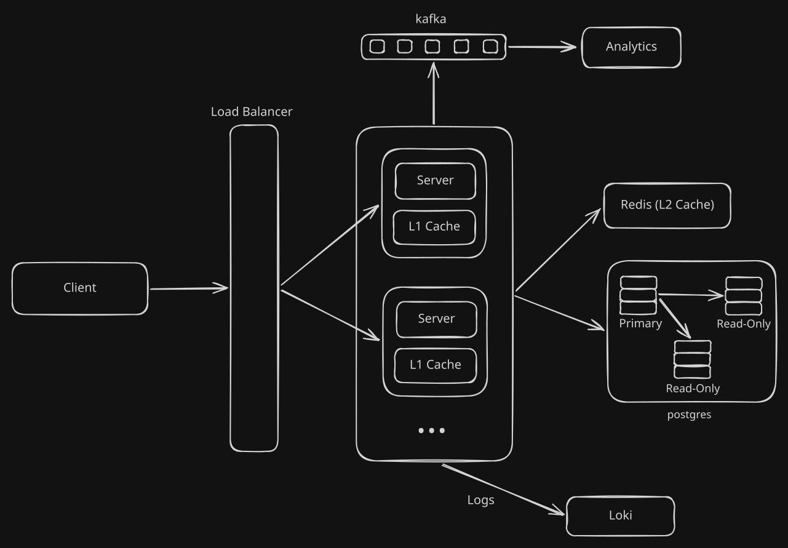

# Zipr

URL shortener backend — Fastify, TypeScript, Prisma, PostgreSQL, Redis.

Auto short URLs are derived from the database `id` via Base62 (`encodeBase62(id)`); Pro users can also pick a custom slug.

## System design



## Stack

- Node.js + TypeScript (strict, ESM)
- Fastify 5
- Prisma 7 + PostgreSQL (`@prisma/adapter-pg`)
- Two-level cache: in-memory, then Redis (`ioredis`)
- JWT auth (`jose`) + bcrypt

## Setup

```bash
npm install
cp .env.example .env   # fill in the values
sudo docker compose up postgres redis -d
npx prisma generate
npx prisma migrate dev
npm run build
npm start
```

Server listens on `http://localhost:$API_PORT`. Swagger UI is at `/docs`.

## API

| Method | Path | Auth | Description |
|--------|------|------|-------------|
| `GET` | `/health` | — | Health check |
| `POST` | `/user/create` | — | Create a user (`email`, `password`) |
| `POST` | `/user/login` | — | Log in with `email` + `password`, returns a JWT |
| `POST` | `/shorten/auto` | JWT | Create an auto-generated short URL (`longUrl`) |
| `POST` | `/shorten/custom` | JWT, `Tier.Pro` | Create a short URL with your own slug (`longUrl`, `shortUrl`) |
| `GET` | `/a/:shortUrl` | — | Redirect an auto short URL to its long URL (301) |
| `GET` | `/:shortUrl` | — | Redirect a custom short URL to its long URL (301) |
| `GET` | `/admin/dummy` | JWT, `Role.Admin` | Admin-only placeholder |

Authenticated routes expect `Authorization: Bearer <token>`.

### Examples

```bash
curl http://localhost:3000/health

curl -X POST http://localhost:3000/user/create \
  -H "Content-Type: application/json" \
  -d '{"email": "user@example.com", "password": "..."}'

curl -X POST http://localhost:3000/shorten/auto \
  -H "Authorization: Bearer $TOKEN" \
  -H "Content-Type: application/json" \
  -d '{"longUrl": "https://example.com"}'
```

## Development

Pre-commit runs [gitleaks](https://github.com/gitleaks/gitleaks) on staged files.

```bash
npm run build
npx tsx src/main.ts    # run without build (dev)
npm test               # unit + integration; needs the postgres container up
```

See `CLAUDE.md` for the architecture and test setup.

## License

ISC
